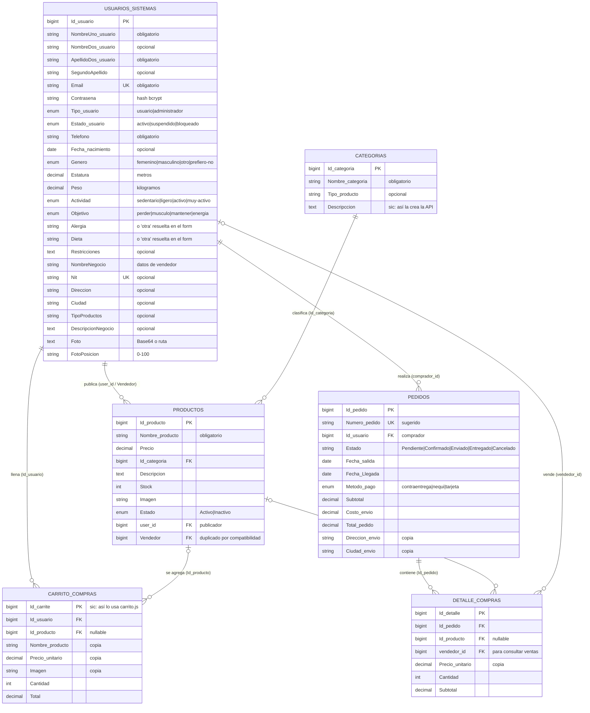

# MER de Nutrik — modelo entidad-relación del proyecto

Modelo construido a partir del **código real** del frontend (formularios y adaptadores de API),
no de suposiciones. Fuentes principales:

- `src/Pages/Cliente/Register.jsx` — formulario de registro en 3 pasos.
- `src/Pages/Cliente/Perfil.jsx` y `src/api/usuarios.js` — edición de perfil y mapeo de columnas.
- `src/Pages/Cliente/Checkout.jsx` y `src/api/pedidos.js` — pedidos y detalle de compra.
- `src/api/carrito.js`, `src/api/productos.js`, `src/Context/ProductProvider.jsx` — carrito, productos y categorías.

> Convención: se conservan los nombres de columna que **la API ya consume**
> (`Id_usuario`, `NombreUno_usuario`, `Id_carrite`, etc.). Cambiarlos en el backend obligaría
> a reescribir los adaptadores `aApi()` / `desdeApi()` del frontend.

---

## 1. Diagrama entidad-relación

Pégalo en [mermaid.live](https://mermaid.live), GitHub, Notion o VS Code con extensión Mermaid.



### Versión compacta (cardinalidades)

```
USUARIO ──1:N──> PRODUCTOS            (publica; no es un rol separado)
CATEGORÍA ──1:N──> PRODUCTOS
USUARIO ──1:N──> CARRITO_COMPRAS      (una línea por producto)
PRODUCTO ──0:N──> CARRITO_COMPRAS
USUARIO ──1:N──> PEDIDOS              (como comprador)
PEDIDO ──1:N──> DETALLE_COMPRAS
PRODUCTO ──0:N──> DETALLE_COMPRAS
USUARIO ──0:N──> DETALLE_COMPRAS      (como vendedor)
```

| Relación | Cardinalidad | Clave | Regla |
|---|---|---|---|
| Usuario → Productos | 1:N | `productos.user_id` → `Id_usuario` | Solo el publicador puede editar/borrar. |
| Categoría → Productos | 1:N | `Id_categoria` | Si no existe, el frontend la crea con `Tipo_producto='General'`. |
| Usuario → Carrito | 1:N líneas | `Id_usuario` | `vaciarCarrito()` filtra por este campo. |
| Producto → Carrito | 0:N | `Id_producto` (nullable) | Se guarda copia de nombre, precio e imagen. |
| Usuario → Pedidos | 1:N | `Id_usuario` / `comprador_id` | El comprador nunca debe comprar sus propios productos. |
| Pedido → Detalle | 1:N | `Id_pedido` | Un pedido siempre tiene al menos una línea. |
| Producto → Detalle | 0:N | `Id_producto` (nullable) | Al borrar un producto, el histórico se conserva. |
| Usuario → Detalle | 0:N | `vendedor_id` | Permite calcular ventas por vendedor. |

---

## 2. El formulario de registro y dónde cae cada dato

`Register.jsx` tiene 3 pasos. `registrarUsuario()` en `src/api/usuarios.js` convierte cada
campo React a la columna real de `usuarios_sistemas` mediante el objeto `CAMPOS`.

### Paso 1 — Datos personales

| Campo del formulario | Columna | Tipo sugerido | Regla del formulario |
|---|---|---|---|
| `primerNombre` | `NombreUno_usuario` | VARCHAR(80) | Obligatorio |
| `segundoNombre` | `NombreDos_usuario` | VARCHAR(80) | Opcional |
| `primerApellido` | `ApellidoDos_usuario` | VARCHAR(80) | Obligatorio (nombre legado confuso) |
| `segundoApellido` | `SegundoApellido` | VARCHAR(80) | Opcional |
| `email` | `Email` | VARCHAR(150) | Obligatorio, **UNIQUE**, validado con regex |
| `telefono` | `Telefono` | VARCHAR(30) | Obligatorio |
| `fechaNacimiento` | `Fecha_nacimiento` | DATE | Opcional |
| `genero` | `Genero` | ENUM | Obligatorio: femenino / masculino / otro / prefiero-no |

### Paso 2 — Cuerpo y actividad

| Campo del formulario | Columna | Tipo sugerido | Regla del formulario |
|---|---|---|---|
| `peso` | `Peso` | DECIMAL(5,2) | Obligatorio. El form agrega `" kg"`; a la BD va solo `58.00`. |
| `estatura` | `Estatura` | DECIMAL(4,2) | Obligatorio. En metros, p. ej. `1.70`. |
| `actividad` | `Actividad` | ENUM | Obligatorio: sedentario / ligero / activo / muy-activo |
| `objetivo` | `Objetivo` | ENUM | Obligatorio: perder / musculo / mantener / energia |
| `frecuencia` | **sin columna hoy** | — ⚠️ | Se captura pero `aApi()` no la envía. |
| `nivel` | **sin columna hoy** | — ⚠️ | Se captura pero `aApi()` no la envía. |
| `horario` | **sin columna hoy** | — ⚠️ | Se captura pero `aApi()` no la envía. |

### Paso 3 — Alimentación y acceso

| Campo del formulario | Columna | Tipo sugerido | Regla del formulario |
|---|---|---|---|
| `alergia` + `otroAlergia` | `Alergia` | VARCHAR(100) | Si es "otro", se guarda el texto escrito. |
| `dieta` + `otroDieta` | `Dieta` | VARCHAR(100) | Igual que alergia. |
| `restricciones` | `Restricciones` | TEXT | Opcional |
| `password` | `Contrasena` | VARCHAR(255) | Mínimo 8 caracteres; **guardar con hash**, nunca plano. |
| `confirmPassword` | — | — | Validación solo en el cliente; **no se almacena**. |

### Campos que el registro agrega automáticamente

| Campo | Valor | Origen |
|---|---|---|
| `Tipo_usuario` / `role` | `usuario` | `registrarUsuario()` (el admin NO se registra por la web) |
| `Estado_usuario` / `estado` | `activo` | `registrarUsuario()` |
| `nombreCompleto` | concentración de los 4 nombres | Se calcula en React; no es columna, se deriva al leer. |

### Datos de negocio (perfil vendedor)

Viven **en la misma fila** de `usuarios_sistemas`, no en una tabla de vendedores:
`NombreNegocio`, `Nit`, `Direccion`, `Ciudad`, `TipoProductos`, `DescripcionNegocio`.
El rol de vendedor no existe: cualquier `usuario` activo publica productos; `Estado_usuario`
controla si puede hacerlo (`puedeVender()` en `src/constants/roles.js`).

> El administrador usa otra tabla: la `users` de Laravel (`/login`, con `email` + `password`).
> Es una cuenta privada creada por seeder; **no se mezcla con `usuarios_sistemas`**.

---

## 3. Diccionario de entidades

### `usuarios_sistemas` — persona + negocio (raíz del modelo)

| Atributo | PK/FK | Notas |
|---|---|---|
| `Id_usuario` | PK | Autoincremental. Lo usa la sesión (`desdeApi`). |
| `Email` | UK | Único; se valida en `/usuarios/verificar`. |
| `Contrasena` | | Hash bcrypt en servidor. Nunca Base64 ni texto plano. |
| `Tipo_usuario` | | `usuario` \| `administrador` (este último, solo en Laravel `users`). |
| `Estado_usuario` | | `activo` \| `suspendido` \| `bloqueado`. |
| `Foto`, `FotoPosicion` | | Base64 o ruta + posición vertical del recorte (0–100). |
| Resto | | Ver §2. |

### `categorias`

| Atributo | PK/FK | Notas |
|---|---|---|
| `Id_categoria` | PK | Referenciada por `productos`. |
| `Nombre_categoria` | | Ej.: Congelados, Snacks. |
| `Tipo_producto` | | Por defecto `'General'` cuando la crea el frontend. |
| `Descripccion` | | Error ortográfico confirmado en `src/api/pedidos.js`; se mantiene por compatibilidad. |

### `productos`

| Atributo | PK/FK | Notas |
|---|---|---|
| `Id_producto` | PK | |
| `Id_categoria` | FK → `categorias` | |
| `user_id` / `Vendedor` | FK → `usuarios_sistemas` | El frontend envía ambos; **idealmente uno solo**. |
| `Precio` | | DECIMAL(10,2), nunca FLOAT. |
| `Stock` | | INT UNSIGNED. |
| `Estado` | | `Activo` \| `Inactivo`. |
| `Imagen` | | URL o ruta en storage. |

### `carrito_compras`

Tabla de líneas, no de "carritos" como objeto: `Checkout.jsx` inserta una fila por
producto con `Id_usuario` y luego `vaciarCarrito()` las borra por ese mismo id.

| Atributo | PK/FK | Notas |
|---|---|---|
| `Id_carrite` | PK | Nombre exacto usado en `carrito.js` (typo legado). |
| `Id_usuario` | FK → `usuarios_sistemas` | Define a quién pertenece la línea. |
| `Id_producto` | FK → `productos` (nullable) | Puede ser null para productos del catálogo demo. |
| `Nombre_producto`, `Precio_unitario`, `Imagen` | | **Snapshots**: no cambian si el vendedor edita el producto. |
| `Cantidad`, `Total` | | `Total = Precio_unitario × Cantidad`. |

### `pedidos`

| Atributo | PK/FK | Notas |
|---|---|---|
| `Id_pedido` | PK | El frontend compone `NUT-000001` solo para mostrar. |
| `Numero_pedido` | UK sugerido | Hoy no se persiste; conviene generarlo en el servidor. |
| `Id_usuario` / `comprador_id` | FK → `usuarios_sistemas` | Comprador. |
| `Fecha_salida`, `Fecha_Llegada` | | Hoy: hoy y hoy + 3 días. |
| `Metodo_pago` | | `contraentrega` \| `nequi` \| `tarjeta`. |
| `Subtotal`, `Costo_envio`, `Total_pedido` | | Envío gratis si subtotal ≥ 100.000; si no, 9.000. |
| `Direccion_envio`, `Ciudad_envio` | | Copias: si el usuario cambia su dirección, el pedido no cambia. |

### `detalle_compras`

| Atributo | PK/FK | Notas |
|---|---|---|
| `Id_detalle` | PK sugerido | El código solo usa `Id_pedido` + `Id_producto`. |
| `Id_pedido` | FK → `pedidos` | Obligatorio. |
| `Id_producto` | FK → `productos` (nullable) | `ON DELETE SET NULL` recomendado. |
| `vendedor_id` | FK → `usuarios_sistemas` | Origen de las ventas por usuario. |
| `Precio_unitario`, `Cantidad`, `Subtotal` | | Copias del momento de la compra. |

---

## 4. Reglas de integridad y negocio

1. **Un correo, una cuenta.** `Email` es UNIQUE.
2. **Contraseña hasheada.** `Contrasena` se guarda con `Hash::make()`; `confirmPassword` nunca se guarda.
3. **Sin auto-registro de administrador.** `Tipo_usuario` se fuerza a `usuario` en el endpoint público.
4. **Higiene de unidades.** `Peso` y `Estatura` son numéricos; el sufijo `" kg"` se agrega al mostrar.
5. **El estado manda.** `Estado_usuario !== 'activo'` impide publicar/editar productos.
6. **No comprar propio producto.** `vendedor_id !== comprador_id`, validado en `Checkout.jsx` y en `pedidos.js`.
7. **Histórico inmutable.** Precio, nombre, dirección e imagen se copian al pedido/detalle/carrito.
8. **Borrar producto no borra ventas.** `detalle_compras.Id_producto` debe ser nullable.
9. **Dinero decimal.** Todos los montos `DECIMAL(10,2)`.
10. **Los 3 campos huérfanos.** `frecuencia`, `nivel` y `horario` requieren columnas nuevas o eliminarse del formulario; hoy se pierden silenciosamente.

---

## 5. DDL de referencia (MySQL 8)

Ajustable a Laravel migrations. Respeta los nombres que ya consume la API.

```sql
CREATE TABLE usuarios_sistemas (
  Id_usuario BIGINT UNSIGNED AUTO_INCREMENT PRIMARY KEY,
  NombreUno_usuario VARCHAR(80) NOT NULL,
  NombreDos_usuario VARCHAR(80) NULL,
  ApellidoDos_usuario VARCHAR(80) NOT NULL,
  SegundoApellido VARCHAR(80) NULL,
  Email VARCHAR(150) NOT NULL UNIQUE,
  Contrasena VARCHAR(255) NOT NULL,
  Tipo_usuario ENUM('usuario','administrador') NOT NULL DEFAULT 'usuario',
  Estado_usuario ENUM('activo','suspendido','bloqueado') NOT NULL DEFAULT 'activo',
  Telefono VARCHAR(30) NOT NULL,
  Fecha_nacimiento DATE NULL,
  Genero ENUM('femenino','masculino','otro','prefiero-no') NOT NULL,
  Estatura DECIMAL(4,2) NULL,
  Peso DECIMAL(5,2) NULL,
  Actividad ENUM('sedentario','ligero','activo','muy-activo') NULL,
  Objetivo ENUM('perder','musculo','mantener','energia') NULL,
  Alergia VARCHAR(100) NULL,
  Dieta VARCHAR(100) NULL,
  Restricciones TEXT NULL,
  NombreNegocio VARCHAR(150) NULL,
  Nit VARCHAR(30) NULL UNIQUE,
  Direccion VARCHAR(255) NULL,
  Ciudad VARCHAR(100) NULL,
  TipoProductos VARCHAR(100) NULL,
  DescripcionNegocio TEXT NULL,
  Foto TEXT NULL,
  FotoPosicion VARCHAR(10) NULL,
  created_at TIMESTAMP NULL DEFAULT CURRENT_TIMESTAMP,
  updated_at TIMESTAMP NULL DEFAULT CURRENT_TIMESTAMP ON UPDATE CURRENT_TIMESTAMP
);

CREATE TABLE categorias (
  Id_categoria BIGINT UNSIGNED AUTO_INCREMENT PRIMARY KEY,
  Nombre_categoria VARCHAR(100) NOT NULL,
  Tipo_producto VARCHAR(100) NULL,
  Descripccion TEXT NULL
);

CREATE TABLE productos (
  Id_producto BIGINT UNSIGNED AUTO_INCREMENT PRIMARY KEY,
  Nombre_producto VARCHAR(150) NOT NULL,
  Precio DECIMAL(10,2) NOT NULL,
  Id_categoria BIGINT UNSIGNED NULL,
  Descripcion TEXT NULL,
  Stock INT UNSIGNED NOT NULL DEFAULT 0,
  Imagen VARCHAR(500) NULL,
  Estado ENUM('Activo','Inactivo') NOT NULL DEFAULT 'Activo',
  user_id BIGINT UNSIGNED NULL,
  Vendedor BIGINT UNSIGNED NULL,
  created_at TIMESTAMP NULL DEFAULT CURRENT_TIMESTAMP,
  updated_at TIMESTAMP NULL DEFAULT CURRENT_TIMESTAMP ON UPDATE CURRENT_TIMESTAMP,
  CONSTRAINT fk_producto_categoria FOREIGN KEY (Id_categoria) REFERENCES categorias (Id_categoria),
  CONSTRAINT fk_producto_usuario FOREIGN KEY (user_id) REFERENCES usuarios_sistemas (Id_usuario)
);

CREATE TABLE carrito_compras (
  Id_carrite BIGINT UNSIGNED AUTO_INCREMENT PRIMARY KEY,
  Id_usuario BIGINT UNSIGNED NOT NULL,
  Id_producto BIGINT UNSIGNED NULL,
  Nombre_producto VARCHAR(150) NOT NULL,
  Precio_unitario DECIMAL(10,2) NOT NULL,
  Imagen VARCHAR(500) NULL,
  Cantidad INT UNSIGNED NOT NULL DEFAULT 1,
  Total DECIMAL(10,2) NOT NULL,
  CONSTRAINT fk_carrito_usuario FOREIGN KEY (Id_usuario) REFERENCES usuarios_sistemas (Id_usuario),
  CONSTRAINT fk_carrito_producto FOREIGN KEY (Id_producto) REFERENCES productos (Id_producto) ON DELETE SET NULL
);

CREATE TABLE pedidos (
  Id_pedido BIGINT UNSIGNED AUTO_INCREMENT PRIMARY KEY,
  Numero_pedido VARCHAR(30) NULL UNIQUE,
  Id_usuario BIGINT UNSIGNED NOT NULL,
  Estado ENUM('Pendiente','Confirmado','Enviado','Entregado','Cancelado') NOT NULL DEFAULT 'Pendiente',
  Fecha_salida DATE NULL,
  Fecha_Llegada DATE NULL,
  Metodo_pago ENUM('contraentrega','nequi','tarjeta') NOT NULL,
  Subtotal DECIMAL(10,2) NOT NULL,
  Costo_envio DECIMAL(10,2) NOT NULL DEFAULT 0,
  Total_pedido DECIMAL(10,2) NOT NULL,
  Direccion_envio VARCHAR(255) NOT NULL,
  Ciudad_envio VARCHAR(100) NOT NULL,
  created_at TIMESTAMP NULL DEFAULT CURRENT_TIMESTAMP,
  updated_at TIMESTAMP NULL DEFAULT CURRENT_TIMESTAMP ON UPDATE CURRENT_TIMESTAMP,
  CONSTRAINT fk_pedido_usuario FOREIGN KEY (Id_usuario) REFERENCES usuarios_sistemas (Id_usuario)
);

CREATE TABLE detalle_compras (
  Id_detalle BIGINT UNSIGNED AUTO_INCREMENT PRIMARY KEY,
  Id_pedido BIGINT UNSIGNED NOT NULL,
  Id_producto BIGINT UNSIGNED NULL,
  vendedor_id BIGINT UNSIGNED NULL,
  Precio_unitario DECIMAL(10,2) NOT NULL,
  Cantidad INT UNSIGNED NOT NULL,
  Subtotal DECIMAL(10,2) NOT NULL,
  CONSTRAINT fk_detalle_pedido FOREIGN KEY (Id_pedido) REFERENCES pedidos (Id_pedido) ON DELETE CASCADE,
  CONSTRAINT fk_detalle_producto FOREIGN KEY (Id_producto) REFERENCES productos (Id_producto) ON DELETE SET NULL,
  CONSTRAINT fk_detalle_vendedor FOREIGN KEY (vendedor_id) REFERENCES usuarios_sistemas (Id_usuario)
);
```

---

## 6. Notas finales

- `MODELO-DATOS-NUTRIK.md` propone un esquema alternativo y más normalizado
  (`users` + `cliente_perfiles` + `vendedor_perfiles`). Este MER, en cambio, describe
  **lo que el proyecto consume hoy**. Si vas a migrar, hazlo en una sola dirección y
  actualiza `src/api/usuarios.js`, `src/api/carrito.js`, `src/api/pedidos.js` y
  `src/Context/ProductProvider.jsx` al mismo tiempo.
- `src/utils/actividad.js` guarda el historial de eventos en `localStorage`, **no en BD**;
  por eso no aparece como entidad.
- Para ver el diagrama: abre este archivo en VS Code con la extensión Markdown Preview Mermaid.
