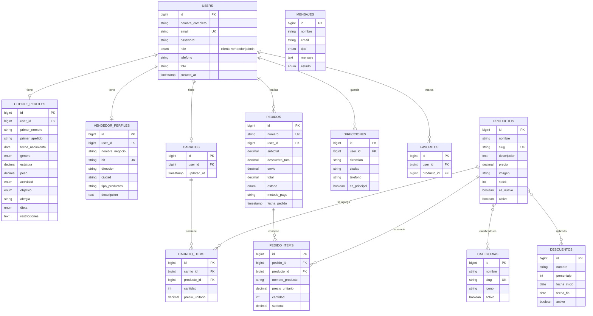

# NUTRIK — Modelo de Datos para Laravel

 diagrama entidad-relación, tablas, migraciones, modelos y endpoints.
Todo está diseñado a partir del código real de la app React que ya tienes.

---

# 0. EL PROBLEMA QUE RESUELVE ESTE MODELO

La app actual **no tiene base de datos**. Mira cómo funciona hoy:

```jsx
// src/Context/AuthProvider.jsx
const STORAGE_USERS = 'nutrik_users';
localStorage.setItem(STORAGE_USERS, JSON.stringify(lista));
```

**Todo vive en el `localStorage` de tu navegador.** Consecuencias:

| Problema | Por qué pasa |
|---|---|
| Las contraseñas se guardan **en texto plano** | `JSON.stringify` no cifra nada |
| Si borras los datos del navegador, **pierdes las cuentas** | No hay copia en ningún lado |
| Dos navegadores **no ven lo mismo** | Cada uno tiene su propio almacén |
| El vendedor **no ve los pedidos** del cliente | `Pedidos.jsx` lee el carrito de quien mira, no una base de datos |
| El carrito **se pierde al recargar** | Nunca se guardó |

**Laravel + base de datos** arregla todo esto. Y es el paso obligatorio para poder
sustentar que el sistema "maneja datos reales".

---

# 1. EL DIAGRAMA

## 1.1 Versión visual (Mermaid)

Pégalo en cualquier editor que soporte Mermaid (GitHub, Notion, VS Code con
extensión, o [mermaid.live](https://mermaid.live)):



## 1.2 Versión ASCII (para el documento impreso)

```
                        ┌──────────────────┐
                        │      USERS       │
                        │  (todos: cliente, │
                        │   vendedor, admin)│
                        └────────┬─────────┘
          ┌──────────────────────┼──────────────────────┐
          │ 1:1                  │ 1:1                  │ 1:N
   ┌──────┴───────┐      ┌───────┴────────┐    ┌────────┴────────┐
   │CLIENTE_      │      │VENDEDOR_      │    │    PEDIDOS      │
   │PERFILES      │      │PERFILES       │    │  (numero, total,│
   │(salud, peso, │      │(negocio, nit, │    │   estado)       │
   │ dieta)       │      │ ciudad)       │    └────────┬────────┘
   └──────────────┘      └────────────────┘             │ 1:N
                                                   ┌────┴─────┐
   ┌──────────────┐                                  │          │
   │  CATEGORIAS  │                              PEDIDO_    PRODUCTOS
   │  (Congelados,│                                 ITEMS      (nombre,
   │   Snacks...) │                                  │         precio,
   └──────┬───────┘                                  │         stock)
          │ N:N                                      └──────────┬┘
          │  ┌────────────────────┐                        │ N:N
          └──┤PRODUCTO_CATEGORIA  │◄───────────────────────┘
             └────────────────────┘                  ┌──────────────┐
                                                    │  DESCUENTOS  │
   ┌──────────────┐                                  │ (%, desde,   │
   │  CARRITOS    │                                  │  hasta)      │
   │ (1 por       │                                  └──────┬───────┘
   │  cliente)    │                                         │ N:N
   └──────┬───────┘                                ┌────────┴────────┐
          │ 1:N                                    │DESCUENTO_      │
   ┌──────┴───────┐                                │PRODUCTO         │
   │CARRITO_ITEMS │                                └─────────────────┘
   └──────┬───────┘
          │ N:1
      PRODUCTOS
```

## 1.3 Las relaciones, explicadas

| # | Relación | Tipo | Qué significa |
|---|---|---|---|
| 1 | `users` → `cliente_perfiles` | **1:1** | Un usuario cliente tiene un perfil de salud |
| 2 | `users` → `vendedor_perfiles` | **1:1** | Un usuario vendedor tiene datos de su negocio |
| 3 | `users` → `carritos` | **1:1** | Un cliente tiene **un** carrito activo |
| 4 | `users` → `pedidos` | **1:N** | Un cliente puede hacer muchos pedidos |
| 5 | `carritos` → `carrito_items` | **1:N** | Un carrito tiene varias líneas |
| 6 | `productos` → `carrito_items` | **1:N** | Un producto puede estar en muchos carritos |
| 7 | `pedidos` → `pedido_items` | **1:N** | Un pedido tiene varias líneas |
| 8 | `productos` → `pedido_items` | **1:N** | Un producto se puede vender muchas veces |
| 9 | `productos` ↔ `categorias` | **N:N** | Un producto en varias categorías; una categoría con muchos productos |
| 10 | `productos` ↔ `descuentos` | **N:N** | Una promoción aplica a varios productos |
| 11 | `users` ↔ `productos` | **N:N** | Los **favoritos** (el ícono de deseo del Header) |
| 12 | `users` → `mensajes` | **1:N** | Las solicitudes del formulario PQR |

**Las dos N:N son las importantes**, porque en SQL no existen directamente: se
resuelven con **tablas intermedias** (`producto_categoria`, `descuento_producto`,
`favoritos`).

---

# 2. LAS TABLAS, UNA POR UNA

## 2.1 `users` — la base de todo

| Campo | Tipo | Restricciones | Viene de |
|---|---|---|---|
| `id` | bigint | PK, autoincremental | — |
| `nombre_completo` | string | nullable | `nombreCompleto` |
| `email` | string | **UNIQUE**, índice | `email` |
| `password` | string | **HASHED (bcrypt)** | `password` |
| `role` | enum | `cliente`\|`vendedor`\|`admin` | `role` |
| `telefono` | string | nullable | `telefono` |
| `foto` | text | nullable (Base64 o ruta) | `foto` |
| `email_verified_at` | timestamp | nullable | — (nuevo) |
| `remember_token` | string | nullable | — (Laravel) |
| `created_at` / `updated_at` | timestamp | | — |

> 🔒 **El cambio más importante de todo el proyecto:** en React la contraseña se
> guardaba como `juliana123`, legible. En Laravel **nunca** se guarda así.
> Laravel usa `Hash::make()` y genera algo como `$2y$12$abc...irreconocible`.
> Ni tú ni el vendedor pueden leerla. Para compararla: `Hash::check()`.

**¿Por qué una sola tabla y no `clientes` + `vendedores` separadas?**
Porque en el código actual **el login es el mismo** para los dos: se busca por
correo en una sola lista (`users.find(u => u.email === correo)`) y luego se mira
el `role`. Separarlas obligaría a duplicar el login. La tabla `role` lo resuelve
con un campo, y los datos específicos van en las tablas de perfil.

## 2.2 `cliente_perfiles` — la salud del cliente

| Campo | Tipo | Notas |
|---|---|---|
| `id` | bigint | PK |
| `user_id` | bigint | **FK → users.id**, UNIQUE, ON DELETE CASCADE |
| `primer_nombre` | string | obligatorio |
| `segundo_nombre` | string | nullable |
| `primer_apellido` | string | obligatorio |
| `segundo_apellido` | string | nullable |
| `fecha_nacimiento` | date | nullable |
| `genero` | enum | `femenino`\|`masculino`\|`otro`\|`prefiero_no` |
| `estatura` | decimal(4,2) | en metros (1.62) |
| `peso` | decimal(5,2) | en kg (58.00) |
| `actividad` | enum | `sedentario`\|`ligero`\|`activo`\|`muy_activo` |
| `objetivo` | enum | `perder`\|`musculo`\|`mantener`\|`energia` |
| `alergia` | string | nullable (`gluten`, `lactosa`… u otro) |
| `dieta` | enum | nullable (`vegetariano`\|`vegano`\|`keto`… ) |
| `restricciones` | text | nullable |

> **Por qué separar los 4 nombres si ya existe `nombre_completo`?** Porque el
> formulario de registro (`Register.jsx`) los pide separados. Con los 4 puedes
> saludar por el nombre y además ordenar por apellido. Es lo mismo que hace
> cualquier sistema serio.

> **Ojo con los decimales.** En el código actual el peso se guardaba como el
> **texto** `"58 kg"` (`manejarPeso` le pegaba la unidad). En la base va el
> **número** `58.00`; la unidad la pones tú al mostrar. Guardar `"58 kg"` en un
> campo numérico sería un error.

## 2.3 `vendedor_perfiles` — el negocio

| Campo | Tipo | Notas |
|---|---|---|
| `id` | bigint | PK |
| `user_id` | bigint | FK → users.id, UNIQUE, CASCADE |
| `nombre_negocio` | string | "Tienda Nutrik" |
| `nit` | string | nullable, UNIQUE (documento empresarial colombiano) |
| `direccion` | string | nullable |
| `ciudad` | string | nullable |
| `tipo_productos` | string | nullable |
| `descripcion` | text | nullable |

## 2.4 `categorias` — ⚠️ la que falta hoy

| Campo | Tipo | Notas |
|---|---|---|
| `id` | bigint | PK |
| `nombre` | string | "Congelados" |
| `slug` | string | **UNIQUE**, "congelados" (para la URL) |
| `icono` | string | nullable (ruta al SVG) |
| `activo` | boolean | default true |

**Esta tabla resuelve un bug real.** Hoy el `Navbar.jsx` tiene 8 categorías
escritas a mano y **solo 2 tienen ruta**; las otras 6 dan 404. Y `Snacks.jsx` y
`Frozen.jsx`Each tienen su propia lista de productos escrita a mano, aparte del
catálogo central. Con esta tabla, las 8 categorías se crean desde la base y los
enlaces se generan con un `@foreach`.

## 2.5 `productos`

| Campo | Tipo | Notas |
|---|---|---|
| `id` | bigint | PK |
| `nombre` | string | "Creatina Monohidratada" |
| `slug` | string | **UNIQUE**, "creatina-monohidratada" |
| `descripcion` | text | |
| `precio` | decimal(10,2) | **NUNCA float** — el dinero no se guarda con decimales flotantes |
| `imagen` | string | URL o ruta local |
| `stock` | unsignedInteger | default 0 |
| `es_nuevo` | boolean | default false (reemplaza `etiqueta: "nuevo"`) |
| `activo` | boolean | default true |
| `timestamps` | | |

> **Un cambio de diseño importante:** en `productosData.js` cada producto tiene
> `etiqueta: "" | "nuevo" | "descuento"`. Eso tiene un problema: **un producto
> no puede ser nuevo Y estar en descuento a la vez**, porque solo hay un campo.
>
> En el modelo nuevo: "nuevo" es un **boolean** (`es_nuevo`) y el descuento sale
> de la tabla `descuentos`. Así un producto puede ser las dos cosas.

> **Sobre las imágenes:** hoy apuntan a URLs de Pinterest y Unsplash. Eso es
> frágil (si una imagen se borra, se rompe). Lo ideal: `string imagen` con la
> ruta de un archivo en `storage/app/public/productos/`, subida por el vendedor.

## 2.6 `producto_categoria` — tabla intermedia

| Campo | Tipo | Notas |
|---|---|---|
| `producto_id` | bigint | FK, parte de la PK compuesta |
| `categoria_id` | bigint | FK, parte de la PK compuesta |

## 2.7 `descuentos` — las promociones

| Campo | Tipo | Notas |
|---|---|---|
| `id` | bigint | PK |
| `nombre` | string | "Promo_native Julio" |
| `porcentaje` | unsignedTinyInteger | 0–100 |
| `fecha_inicio` | date | |
| `fecha_fin` | date | |
| `activo` | boolean | default true |

Las fechas son lo que hoy **no existe**: en `productosData.js` el `descuento: 22`
es permanente. Con fechas puedes hacer ofertas de verdad.

## 2.8 `descuento_producto` — tabla intermedia

| Campo | Tipo | Notas |
|---|---|---|
| `descuento_id` | bigint | FK |
| `producto_id` | bigint | FK |

## 2.9 `carritos` y `carrito_items`

**`carritos`**

| Campo | Tipo | Notas |
|---|---|---|
| `id` | bigint | PK |
| `user_id` | bigint | **UNIQUE** → un carrito por cliente |
| `timestamps` | | |

**`carrito_items`**

| Campo | Tipo | Notas |
|---|---|---|
| `id` | bigint | PK |
| `carrito_id` | bigint | FK, CASCADE |
| `producto_id` | bigint | FK, RESTRICT |
| `cantidad` | unsignedInteger | default 1 |
| `precio_unitario` | decimal(10,2) | **copia del precio al agregarlo** |

> **Por qué `precio_unitario` si ya está en `productos.precio`?** Porque si hoy
> agregas un producto a $85.000 y el vendedor sube el precio a $95.000, tu
> carrito debe **mantener los $85.000**. Es el mismo principio que en
> `pedido_items`.

> **Esto es lo que arregla el carrito que se borra al recargar:** al abrir la
> página, el backend devuelve el carrito guardado.

## 2.10 `pedidos` y `pedido_items`

**`pedidos`**

| Campo | Tipo | Notas |
|---|---|---|
| `id` | bigint | PK |
| `numero` | string | **UNIQUE**, "NUT-482913" |
| `user_id` | bigint | FK → users.id |
| `subtotal` | decimal(10,2) | suma de los ítems |
| `descuento_total` | decimal(10,2) | default 0 |
| `envio` | decimal(10,2) | 0 si supera $100.000, si no 9000 |
| `total` | decimal(10,2) | subtotal − descuento + envío |
| `estado` | enum | `pendiente`\|`confirmado`\|`enviado`\|`entregado`\|`cancelado` |
| `metodo_pago` | enum | `tarjeta`\|`pseb`\|`efectivo` |
| `direccion_envio` | text | **copia** de la dirección en el momento de comprar |
| `fecha_pedido` | timestamp | |
| `fecha_entrega` | timestamp | nullable |

> **El `numero` ya existe en el código**, pero se genera al azar con
> `Math.random()` **en el navegador**. Acá lo genera el servidor, que es lo
> correcto: garantiza que no se repita (por eso es UNIQUE).

> **`direccion_envio` es una copia a propósito.** Si el cliente mañana cambia su
> dirección, el pedido antiguo debe seguir mostrando a dónde se envió.

**`pedido_items`**

| Campo | Tipo | Notas |
|---|---|---|
| `id` | bigint | PK |
| `pedido_id` | bigint | FK, CASCADE |
| `producto_id` | bigint | FK, **SET NULL** + nullable |
| `nombre_producto` | string | **copia** del nombre |
| `precio_unitario` | decimal(10,2) | **copia** del precio |
| `cantidad` | unsignedInteger | |
| `subtotal` | decimal(10,2) | precio × cantidad |

> **Por qué copiar el nombre y `ON DELETE SET NULL`?** Porque si el vendedor
> borra un producto del catálogo, los pedidos ya realizados **no deben
> desaparecer**. El registro histórico se queda.

## 2.11 Tablas opcionales (fase 2)

| Tabla | Para qué | Origen en el código |
|---|---|---|
| `direcciones` | Direcciones guardadas del cliente | El checkout pide la dirección cada vez |
| `favoritos` | Productos marcados con deseo | **Ya existe el ícono de deseo** en `Header.jsx` pero no hace nada |
| `mensajes` | Solicitudes del formulario PQR | `Cliente/Contact.jsx` (hoy va a un email externo) |

> **`mensajes` NO tiene `user_id` a propósito.** Es un formulario público: lo
> puede llenar alguien que nunca se ha registrado en Nutrik, por eso guarda su
> propio `nombre` y `email` en vez de una clave foránea. Por esa misma razón el
> diagrama de la sección 1.1 no lo conecta con `USERS`.

---

# 3. LAS MIGRACIONES DE LARAVEL (código listo)

## 3.0 Preparación

```bash
# Crear el proyecto (NO lo pongas dentro de Admin-Sena)
composer create-project laravel/laravel nutrik-api
cd nutrik-api
```

> ⚠️ **No lo metas dentro de `Admin-Sena`.** Ese es otro proyecto (centro de
> formación del SENA). Mezclarlos generaría conflictos en las migraciones.

**Sobre la base de datos:** tu `.env` de Admin-Sena dice `mysql`, pero
**MySQL no está instalado** en tu equipo. Tienes dos opciones:

**Opción A — Instalar MySQL** (más cercano a producción):
```bash
brew install mysql
brew services start mysql
```

**Opción B — Usar SQLite ahora** (cero instalación, ideal para desarrollar):
```env
# .env
DB_CONNECTION=sqlite
DB_DATABASE=database/database.sqlite
```
```bash
touch database/database.sqlite
```

En `config/database.php` no hay que cambiar nada: SQLite ya viene configurado en
Laravel 12.

## 3.1 users (modificar la que ya trae Laravel)

```php
<?php
// database/migrations/0001_01_01_000000_create_users_table.php

use Illuminate\Database\Migrations\Migration;
use Illuminate\Database\Schema\Blueprint;
use Illuminate\Support\Facades\Schema;

return new class extends Migration
{
    public function up(): void
    {
        Schema::create('users', function (Blueprint $table) {
            $table->id();
            $table->string('nombre_completo')->nullable();
            $table->string('email')->unique();
            $table->timestamp('email_verified_at')->nullable();
            $table->string('password');
            $table->enum('role', ['cliente', 'vendedor', 'admin'])->default('cliente');
            $table->string('telefono')->nullable();
            $table->text('foto')->nullable();
            $table->rememberToken();
            $table->timestamps();
        });

        Schema::create('password_reset_tokens', function (Blueprint $table) {
            $table->string('email')->primary();
            $table->string('token');
            $table->timestamp('created_at')->nullable();
        });

        Schema::create('sessions', function (Blueprint $table) {
            $table->string('id')->primary();
            $table->foreignId('user_id')->nullable()->index();
            $table->string('ip_address', 45)->nullable();
            $table->text('user_agent')->nullable();
            $table->longText('payload');
            $table->integer('last_activity')->index();
        });
    }

    public function down(): void
    {
        Schema::dropIfExists('sessions');
        Schema::dropIfExists('password_reset_tokens');
        Schema::dropIfExists('users');
    }
};
```

## 3.2 Los perfiles

```php
<?php
// database/migrations/2026_09_29_100000_create_perfiles_tables.php

use Illuminate\Database\Migrations\Migration;
use Illuminate\Database\Schema\Blueprint;
use Illuminate\Support\Facades\Schema;

return new class extends Migration
{
    public function up(): void
    {
        Schema::create('cliente_perfiles', function (Blueprint $table) {
            $table->id();
            $table->foreignId('user_id')->unique()->constrained('users')->cascadeOnDelete();
            $table->string('primer_nombre');
            $table->string('segundo_nombre')->nullable();
            $table->string('primer_apellido');
            $table->string('segundo_apellido')->nullable();
            $table->date('fecha_nacimiento')->nullable();
            $table->enum('genero', ['femenino', 'masculino', 'otro', 'prefiero_no'])->nullable();
            $table->decimal('estatura', 4, 2)->nullable();   // metros
            $table->decimal('peso', 5, 2)->nullable();       // kg
            $table->enum('actividad', ['sedentario', 'ligero', 'activo', 'muy_activo'])->nullable();
            $table->enum('objetivo', ['perder', 'musculo', 'mantener', 'energia'])->nullable();
            $table->string('alergia')->nullable();
            $table->enum('dieta', ['vegetariano', 'vegano', 'pescetariano', 'keto', 'sin_gluten', 'otro'])->nullable();
            $table->text('restricciones')->nullable();
            $table->timestamps();
        });

        Schema::create('vendedor_profiles', function (Blueprint $table) {
            $table->id();
            $table->foreignId('user_id')->unique()->constrained('users')->cascadeOnDelete();
            $table->string('nombre_negocio');
            $table->string('nit')->nullable()->unique();
            $table->string('direccion')->nullable();
            $table->string('ciudad')->nullable();
            $table->string('tipo_productos')->nullable();
            $table->text('descripcion')->nullable();
            $table->timestamps();
        });
    }

    public function down(): void
    {
        Schema::dropIfExists('vendedor_profiles');
        Schema::dropIfExists('cliente_perfiles');
    }
};
```

## 3.3 Catálogo

```php
<?php
// database/migrations/2026_09_29_110000_create_catalogo_tables.php

use Illuminate\Database\Migrations\Migration;
use Illuminate\Database\Schema\Blueprint;
use Illuminate\Support\Facades\Schema;

return new class extends Migration
{
    public function up(): void
    {
        Schema::create('categorias', function (Blueprint $table) {
            $table->id();
            $table->string('nombre');
            $table->string('slug')->unique();
            $table->string('icono')->nullable();
            $table->boolean('activo')->default(true);
            $table->timestamps();
        });

        Schema::create('productos', function (Blueprint $table) {
            $table->id();
            $table->string('nombre');
            $table->string('slug')->unique();
            $table->text('descripcion')->nullable();
            $table->decimal('precio', 10, 2);
            $table->string('imagen')->nullable();
            $table->unsignedInteger('stock')->default(0);
            $table->boolean('es_nuevo')->default(false);
            $table->boolean('activo')->default(true);
            $table->timestamps();

            $table->index('es_nuevo');
            $table->index('activo');
        });

        // N:N productos <-> categorias
        Schema::create('producto_categoria', function (Blueprint $table) {
            $table->id();
            $table->foreignId('producto_id')->constrained('productos')->cascadeOnDelete();
            $table->foreignId('categoria_id')->constrained('categorias')->cascadeOnDelete();
            $table->unique(['producto_id', 'categoria_id']);
        });

        Schema::create('descuentos', function (Blueprint $table) {
            $table->id();
            $table->string('nombre');
            $table->unsignedTinyInteger('porcentaje');
            $table->date('fecha_inicio');
            $table->date('fecha_fin');
            $table->boolean('activo')->default(true);
            $table->timestamps();
        });

        // N:N descuentos <-> productos
        Schema::create('descuento_producto', function (Blueprint $table) {
            $table->id();
            $table->foreignId('descuento_id')->constrained('descuentos')->cascadeOnDelete();
            $table->foreignId('producto_id')->constrained('productos')->cascadeOnDelete();
            $table->unique(['descuento_id', 'producto_id']);
        });
    }

    public function down(): void
    {
        Schema::dropIfExists('descuento_producto');
        Schema::dropIfExists('descuentos');
        Schema::dropIfExists('producto_categoria');
        Schema::dropIfExists('productos');
        Schema::dropIfExists('categorias');
    }
};
```

## 3.4 Carrito y pedidos

```php
<?php
// database/migrations/2026_09_29_120000_create_carrito_pedidos_tables.php

use Illuminate\Database\Migrations\Migration;
use Illuminate\Database\Schema\Blueprint;
use Illuminate\Support\Facades\Schema;

return new class extends Migration
{
    public function up(): void
    {
        Schema::create('carritos', function (Blueprint $table) {
            $table->id();
            $table->foreignId('user_id')->unique()->constrained('users')->cascadeOnDelete();
            $table->timestamps();
        });

        Schema::create('carrito_items', function (Blueprint $table) {
            $table->id();
            $table->foreignId('carrito_id')->constrained('carritos')->cascadeOnDelete();
            $table->foreignId('producto_id')->constrained('productos');
            $table->unsignedInteger('cantidad')->default(1);
            $table->decimal('precio_unitario', 10, 2);
            $table->unique(['carrito_id', 'producto_id']);  // no duplicados
        });

        Schema::create('pedidos', function (Blueprint $table) {
            $table->id();
            $table->string('numero')->unique();
            $table->foreignId('user_id')->constrained('users');
            $table->decimal('subtotal', 10, 2)->default(0);
            $table->decimal('descuento_total', 10, 2)->default(0);
            $table->decimal('envio', 10, 2)->default(0);
            $table->decimal('total', 10, 2)->default(0);
            $table->enum('estado', ['pendiente', 'confirmado', 'enviado', 'entregado', 'cancelado'])
                  ->default('pendiente');
            $table->enum('metodo_pago', ['tarjeta', 'pseb', 'efectivo'])->default('tarjeta');
            $table->text('direccion_envio');
            $table->timestamp('fecha_pedido')->useCurrent();
            $table->timestamp('fecha_entrega')->nullable();
            $table->timestamps();

            $table->index('estado');
            $table->index('fecha_pedido');
        });

        Schema::create('pedido_items', function (Blueprint $table) {
            $table->id();
            $table->foreignId('pedido_id')->constrained('pedidos')->cascadeOnDelete();
            $table->foreignId('producto_id')->nullable()
                  ->constrained('productos')->nullOnDelete();
            $table->string('nombre_producto');       // copia
            $table->decimal('precio_unitario', 10, 2); // copia
            $table->unsignedInteger('cantidad');
            $table->decimal('subtotal', 10, 2);
        });

        Schema::create('direcciones', function (Blueprint $table) {
            $table->id();
            $table->foreignId('user_id')->constrained('users')->cascadeOnDelete();
            $table->string('direccion');
            $table->string('ciudad')->nullable();
            $table->string('telefono')->nullable();
            $table->boolean('es_principal')->default(false);
            $table->timestamps();
        });

        Schema::create('favoritos', function (Blueprint $table) {
            $table->id();
            $table->foreignId('user_id')->constrained('users')->cascadeOnDelete();
            $table->foreignId('producto_id')->constrained('productos')->cascadeOnDelete();
            $table->unique(['user_id', 'producto_id']);
        });

        Schema::create('mensajes', function (Blueprint $table) {
            $table->id();
            $table->string('nombre');
            $table->string('email');
            $table->enum('tipo', ['queja', 'sugerencia', 'consulta']);
            $table->text('mensaje');
            $table->enum('estado', ['nuevo', 'respondido', 'cerrado'])->default('nuevo');
            $table->timestamps();
        });
    }

    public function down(): void
    {
        Schema::dropIfExists('mensajes');
        Schema::dropIfExists('favoritos');
        Schema::dropIfExists('direcciones');
        Schema::dropIfExists('pedido_items');
        Schema::dropIfExists('pedidos');
        Schema::dropIfExists('carrito_items');
        Schema::dropIfExists('carritos');
    }
};
```

## 3.5 Instalar Sanctum (para conectar con React)

```bash
php artisan install:api
php artisan vendor:publish --provider="Laravel\Sanctum\SanctumServiceProvider"
```

Esto crea la tabla `personal_access_tokens`. Es lo que hace que la app React
pueda llamar a la API "como si fuera el usuario".

## 3.6 Correr las migraciones

```bash
php artisan migrate
```

Deberías ver **15 tablas de Nutrik** creadas, más las que ya trae Laravel
(`password_reset_tokens`, `sessions`, `cache`, `jobs`, etc.) y `personal_access_tokens`
que agrega Sanctum en el paso 3.5.

---

# 4. LOS MODELOS DE ELOQUENT

## 4.1 `User.php`

```php
<?php
namespace App\Models;

use Illuminate\Database\Eloquent\Factories\HasFactory;
use Illuminate\Foundation\Auth\User as Authenticatable;
use Illuminate\Notifications\Notifiable;

class User extends Authenticatable
{
    use HasFactory, Notifiable;

    // fillable = qué campos se pueden rellenar desde un formulario.
    // 'password' SÍ va aquí porque el cast 'hashed' (abajo) se encarga de
    // cifrarla automáticamente. Aun así nunca la muestres en la API (ver $hidden).
    protected $fillable = [
        'nombre_completo', 'email', 'password', 'role', 'telefono', 'foto',
    ];

    // 'password' se oculta al convertir a JSON / array.
    protected $hidden = ['password', 'remember_token'];

    protected function casts(): array
    {
        return [
            'email_verified_at' => 'datetime',
            'password' => 'hashed',   // Laravel cifra solo, automáticamente
        ];
    }

    // ---- Relaciones ----

    public function perfilCliente()
    {
        return $this->hasOne(ClientePerfil::class);
    }

    public function perfilVendedor()
    {
        return $this->hasOne(VendedorPerfil::class);
    }

    public function carrito()
    {
        return $this->hasOne(Carrito::class);
    }

    public function pedidos()
    {
        return $this->hasMany(Pedido::class);
    }

    public function direcciones()
    {
        return $this->hasMany(Direccion::class);
    }

    public function favoritos()
    {
        return $this->belongsToMany(Producto::class, 'favoritos')->withTimestamps();
    }

    public function esVendedor(): bool
    {
        return $this->role === 'vendedor';
    }
}
```

> ⭐ **`'password' => 'hashed'` en `casts()`** es la forma más limpia. Laravel
> cifra **automáticamente** cualquier contraseña que asignes. Imposible guardar
> una sin cifrar por accidente.

## 4.2 `ClientePerfil.php`

```php
<?php
namespace App\Models;

use Illuminate\Database\Eloquent\Model;

class ClientePerfil extends Model
{
    protected $fillable = [
        'user_id', 'primer_nombre', 'segundo_nombre',
        'primer_apellido', 'segundo_apellido', 'fecha_nacimiento',
        'genero', 'estatura', 'peso', 'actividad', 'objetivo',
        'alergia', 'dieta', 'restricciones',
    ];

    protected function casts(): array
    {
        return [
            'fecha_nacimiento' => 'date',
            'estatura' => 'decimal:2',
            'peso' => 'decimal:2',
        ];
    }

    public function user()
    {
        return $this->belongsTo(User::class);
    }
}
```

## 4.3 `Producto.php` — el más importante

```php
<?php
namespace App\Models;

use Illuminate\Database\Eloquent\Model;
use Illuminate\Database\Eloquent\Relations\BelongsToMany;

class Producto extends Model
{
    protected $fillable = [
        'nombre', 'slug', 'descripcion', 'precio',
        'imagen', 'stock', 'es_nuevo', 'activo',
    ];

    protected function casts(): array
    {
        return [
            'precio' => 'decimal:2',
            'es_nuevo' => 'boolean',
            'activo' => 'boolean',
        ];
    }

    public function categorias()
    {
        return $this->belongsToMany(Categoria::class, 'producto_categoria');
    }

    public function descuentos()
    {
        return $this->belongsToMany(Descuento::class, 'descuento_producto');
    }

    public function scopeActivos($query)
    {
        return $query->where('activo', true);
    }

    public function scopeConDescuento($query)
    {
        return $query->whereHas('descuentos', function ($q) {
            $q->where('activo', true)
              ->whereDate('fecha_inicio', '<=', now())
              ->whereDate('fecha_fin', '>=', now());
        });
    }

    /** Precio con el descuento activo más alto aplicado. */
    public function getPrecioFinalAttribute(): float
    {
        $descuento = $this->descuentos()
            ->where('activo', true)
            ->whereDate('fecha_inicio', '<=', now())
            ->whereDate('fecha_fin', '>=', now())
            ->orderByDesc('porcentaje')
            ->first();

        if (! $descuento) {
            return (float) $this->precio;
        }

        return round($this->precio * (1 - $descuento->porcentaje / 100), 2);
    }

    // ⚠️ Este accessor hace UNA consulta por producto. Si pintas 22 productos
    // son 22 consultas extra (problema N+1). En el listado del catálogo
    // precarga el descuento: Producto::with('descuentos')->get();

    /** Reemplaza a productosTienda() / productosNuevos() / productosDescuento() */
    public function scopeTienda($query)
    {
        return $query->activos()
            ->whereDoesntHave('descuentos', function ($q) {
                $q->where('activo', true)
                  ->whereDate('fecha_inicio', '<=', now())
                  ->whereDate('fecha_fin', '>=', now());
            })
            ->where('es_nuevo', false);
    }

    public function scopeNuevos($query)
    {
        return $query->activos()->where('es_nuevo', true);
    }
}
```

> **Esto reemplaza las 3 funciones de `productosData.js`.** En vez de filtrar en
> el navegador, ahora el **servidor** decide qué va en cada sección.

## 4.4 `Pedido.php`

```php
<?php
namespace App\Models;

use Illuminate\Database\Eloquent\Model;

class Pedido extends Model
{
    protected $fillable = [
        'numero', 'user_id', 'subtotal', 'descuento_total',
        'envio', 'total', 'estado', 'metodo_pago', 'direccion_envio',
        'fecha_pedido', 'fecha_entrega',
    ];

    protected function casts(): array
    {
        return [
            'subtotal' => 'decimal:2',
            'descuento_total' => 'decimal:2',
            'envio' => 'decimal:2',
            'total' => 'decimal:2',
            'fecha_pedido' => 'datetime',
            'fecha_entrega' => 'datetime',
        ];
    }

    protected static function booted(): void
    {
        // El NÚMERO lo genera el servidor, no el navegador.
        static::creating(function (Pedido $pedido) {
            $pedido->numero ??= 'NUT-' . str_pad(
                (string) random_int(100000, 999999), 6, '0', STR_PAD_LEFT
            );
            $pedido->fecha_pedido ??= now();
        });
    }

    public function user()
    {
        return $this->belongsTo(User::class);
    }

    public function items()
    {
        return $this->hasMany(PedidoItem::class);
    }
}
```

## 4.5 Los demás (resumen)

```php
<?php
// Categoria.php
class Categoria extends Model
{
    protected $fillable = ['nombre', 'slug', 'icono', 'activo'];
    protected function casts(): array { return ['activo' => 'boolean']; }

    public function productos()
    {
        return $this->belongsToMany(Producto::class, 'producto_categoria');
    }
}

// Descuento.php
class Descuento extends Model
{
    protected $fillable = ['nombre', 'porcentaje', 'fecha_inicio', 'fecha_fin', 'activo'];
    protected function casts(): array
    {
        return [
            'fecha_inicio' => 'date',
            'fecha_fin' => 'date',
            'activo' => 'boolean',
        ];
    }

    public function productos()
    {
        return $this->belongsToMany(Producto::class, 'descuento_producto');
    }

    public function estaVigente(): bool
    {
        // startOfDay/endOfDay: 'fecha_fin' se guarda como 00:00:00, así que
        // sin esto el descuento moriría a medianoche del último día.
        return $this->activo
            && $this->fecha_inicio->startOfDay()->lte(now())
            && $this->fecha_fin->endOfDay()->gte(now());
    }
}

// Carrito.php
class Carrito extends Model
{
    protected $fillable = ['user_id'];

    public function user()
    {
        return $this->belongsTo(User::class);
    }

    public function items()
    {
        return $this->hasMany(CarritoItem::class);
    }

    public function getTotalAttribute(): float
    {
        return $this->items->sum(
            fn ($item) => $item->precio_unitario * $item->cantidad
        );
    }
}

// CarritoItem.php
class CarritoItem extends Model
{
    protected $fillable = ['carrito_id', 'producto_id', 'cantidad', 'precio_unitario'];
    protected function casts(): array
    {
        return ['precio_unitario' => 'decimal:2', 'cantidad' => 'integer'];
    }

    public function carrito() { return $this->belongsTo(Carrito::class); }
    public function producto() { return $this->belongsTo(Producto::class); }

    public function getSubtotalAttribute(): float
    {
        return $this->precio_unitario * $this->cantidad;
    }
}

// PedidoItem.php
class PedidoItem extends Model
{
    protected $fillable = [
        'pedido_id', 'producto_id', 'nombre_producto',
        'precio_unitario', 'cantidad', 'subtotal',
    ];
    protected function casts(): array
    {
        return ['precio_unitario' => 'decimal:2', 'subtotal' => 'decimal:2'];
    }

    public function pedido() { return $this->belongsTo(Pedido::class); }
    public function producto() { return $this->belongsTo(Producto::class); }
}

// Mensaje.php
class Mensaje extends Model
{
    protected $fillable = ['nombre', 'email', 'tipo', 'mensaje', 'estado'];
}
```

---

# 5. LOS DATOS INICIALES (seeders)

Sin esto, la base arranca vacía. Convierte tu `productosData.js` en datos reales.

## 5.1 Usuarios demo

```bash
php artisan make:seeder DemoUsuariosSeeder
```

```php
<?php
namespace Database\Seeders;

use App\Models\User;
use App\Models\ClientePerfil;
use App\Models\VendedorPerfil;
use Illuminate\Database\Seeder;
use Illuminate\Support\Facades\Hash;

class DemoUsuariosSeeder extends Seeder
{
    public function run(): void
    {
        // ---------- CLIENTE ----------
        $cliente = User::updateOrCreate(
            ['email' => 'juliana@nutrik.com'],
            [
                'nombre_completo' => 'Juliana Gómez Ríos',
                'password' => Hash::make('juliana123'),
                'role' => 'cliente',
                'telefono' => '3001234567',
            ]
        );

        ClientePerfil::updateOrCreate(
            ['user_id' => $cliente->id],
            [
                'primer_nombre' => 'Juliana',
                'segundo_nombre' => '',
                'primer_apellido' => 'Gómez',
                'segundo_apellido' => 'Ríos',
                'genero' => 'femenino',
                'estatura' => 1.62,
                'peso' => 58.00,
                'actividad' => 'activo',
                'objetivo' => 'perder',
            ]
        );

        // ---------- VENDEDOR ----------
        $vendedor = User::updateOrCreate(
            ['email' => 'tienda@nutrik.com'],
            [
                'nombre_completo' => 'Tienda Nutrik',
                'password' => Hash::make('tienda123'),
                'role' => 'vendedor',
                'telefono' => '3001234567',
            ]
        );

        VendedorPerfil::updateOrCreate(
            ['user_id' => $vendedor->id],
            [
                'nombre_negocio' => 'Tienda Nutrik',
                'nit' => '901234567-8',
                'direccion' => 'Calle 10 # 5-12',
                'ciudad' => 'Bogotá',
                'tipo_productos' => 'Suplementos y snacks saludables',
                'descripcion' => 'Vendemos productos sanos para una vida equilibrada.',
            ]
        );
    }
}
```

> 🔒 Fíjate en `Hash::make('juliana123')`. **Nunca** escribas la contraseña
> directo. Esta es la diferencia entre la app actual (texto plano) y la
> versión segura.
>
> Nota: aquí `Hash::make()` es redundante, porque el cast
> `'password' => 'hashed'` de `User` ya cifra solo. Se deja explícito para que
> quede claro qué está pasando. Si algún día olvidas el `Hash::make()`, el cast
> te salva. Es defensa en dos capas.

## 5.2 Catálogo (migrar tus 22 productos)

```bash
php artisan make:seeder CatalogoSeeder
```

```php
<?php
namespace Database\Seeders;

use App\Models\Categoria;
use App\Models\Descuento;
use App\Models\Producto;
use Illuminate\Database\Seeder;

class CatalogoSeeder extends Seeder
{
    public function run(): void
    {
        // ---- Categorías (las 8 del Navbar) ----
        $categorias = [
            ['nombre' => 'Congelados',   'slug' => 'congelados'],
            ['nombre' => 'Snacks',       'slug' => 'snacks'],
            ['nombre' => 'Frutas',       'slug' => 'frutas'],
            ['nombre' => 'Aves y Pescados', 'slug' => 'aves-pescados'],
            ['nombre' => 'Lácteos y Huevos', 'slug' => 'lacteos-huevos'],
            ['nombre' => 'Cereales y Granos', 'slug' => 'cereales-granos'],
            ['nombre' => 'Vitaminas y Bienestar', 'slug' => 'vitaminas'],
            ['nombre' => 'Suplementos en Polvo', 'slug' => 'suplementos'],
        ];

        foreach ($categorias as $c) {
            Categoria::updateOrCreate(['slug' => $c['slug']], $c);
        }

        // ---- Descuento del 22% ----
        $descuento = Descuento::updateOrCreate(
            ['nombre' => 'Promo Colágeno'],
            [
                'porcentaje' => 22,
                'fecha_inicio' => now()->subMonth(),
                'fecha_fin' => now()->addMonths(2),
                'activo' => true,
            ]
        );

        // ---- Los 22 productos de productosData.js ----
        $productos = [
            // TIENDA (10)
            ['creatine', 'Creatina Monohidratada', 85000, false, 'suplementos'],
            ['yogur', 'Yogur Griego Natural', 12000, false, 'lacteos-huevos'],
            ['detox', 'Té Verde Detox', 18000, false, 'frutas'],
            ['omega', 'Omega 3 Fish Oil', 35000, false, 'vitaminas'],
            ['colageno', 'Colágeno Hidrolizado', 79900, false, 'vitaminas'],
            ['chia', 'Semillas de Chía', 14000, false, 'cereales-granos'],
            ['coco', 'Aceite de Coco Natural', 24000, false, 'cereales-granos'],
            ['maca', 'Maca en Polvo', 28000, false, 'suplementos'],
            ['granola', 'Granola Saludable', 16000, false, 'cereales-granos'],
            ['frutos', 'Mix de Frutos Secos', 22000, false, 'snacks'],

            // NUEVOS (10)
            ['silk', 'Silk - Almendra sin Azúcar', 6200, true, 'lacteos-huevos'],
            ['yogurt-smoothie', 'Yogurt Smoothie', 7500, true, 'lacteos-huevos'],
            ['sandia', 'Sandía Fresca', 8000, true, 'frutas'],
            ['batido', 'Batido Energético', 9500, true, 'suplementos'],
            ['milkaut', 'Milkaut Yogurt', 6800, true, 'lacteos-huevos'],
            ['especias', 'Especias Naturales', 5900, true, null],
            ['arroz', 'Arroz Blanco Integral', 7200, true, 'cereales-granos'],
            ['tostadas', 'Tostadas Sanísimo Horneadas', 6400, true, 'cereales-granos'],
            ['aceite-oliva', 'Aceite de Oliva Extra Virgen', 24000, true, null],
            ['yogur-fresas', 'Yogur con Fresas', 7800, true, 'lacteos-huevos'],

            // DESCUENTOS (2)
            ['colageno-premium', 'Colágeno Hidrolizado PREMIUM', 106000, false, 'vitaminas'],
            ['barra-tosh', 'Barra de cereal TOSH nueces y arándanos', 36050, false, 'snacks'],
        ];

        foreach ($productos as [$slug, $nombre, $precio, $esNuevo, $catSlug]) {
            $producto = Producto::updateOrCreate(
                ['slug' => $slug],
                [
                    'nombre' => $nombre,
                    'descripcion' => $nombre . ' — producto de Nutrik.',
                    'precio' => $precio,
                    'es_nuevo' => $esNuevo,
                    'stock' => 100,
                    'activo' => true,
                ]
            );

            if ($catSlug) {
                $categoria = Categoria::where('slug', $catSlug)->first();
                $producto->categorias()->syncWithoutDetaching([$categoria->id]);
            }

            if (in_array($slug, ['colageno-premium', 'barra-tosh'], true)) {
                $producto->descuentos()->syncWithoutDetaching([$descuento->id]);
            }
        }
    }
}
```

```bash
php artisan db:seed --class=DemoUsuariosSeeder
php artisan db:seed --class=CatalogoSeeder
```

---

# 6. LOS ENDPOINTS (la API)

Estos son los que **reemplazan el `localStorage`**.

## 6.1 Autenticación

| Método | Ruta | Qué hace | Reemplaza a |
|---|---|---|---|
| POST | `/api/register` | Crear cuenta | `register()` |
| POST | `/api/login` | Iniciar sesión | `login()` |
| POST | `/api/logout` | Cerrar sesión | `logout()` |
| GET | `/api/me` | Usuario actual | `useAuth().user` |
| PUT | `/api/perfil` | Actualizar datos | `updateProfile()` |
| POST | `/api/forgot-password` | Recuperar clave | `existeCuenta()` |
| POST | `/api/reset-password` | Cambiar clave | `resetPassword()` |

## 6.2 Catálogo

| Método | Ruta | Qué hace | Reemplaza a |
|---|---|---|---|
| GET | `/api/productos` | Listar con filtros | `productosTienda` |
| GET | `/api/productos/nuevos` | Novedades | `productosNuevos` |
| GET | `/api/productos/descuentos` | Rebajas | `productosDescuento` |
| GET | `/api/productos/{slug}` | Detalle | `buscarProducto()` |
| GET | `/api/categorias` | Todas las categorías | **los 8 links fijos** |

## 6.3 Carrito y pedidos

| Método | Ruta | Qué hace | Reemplaza a |
|---|---|---|---|
| GET | `/api/carrito` | Ver carrito | `useCart().carrito` |
| POST | `/api/carrito` | Agregar producto | `agregarProducto()` |
| PATCH | `/api/carrito/{id}` | Cambiar cantidad | `cambiarCantidad()` |
| DELETE | `/api/carrito/{id}` | Quitar | `eliminarProducto()` |
| POST | `/api/pedidos` | **Crear pedido** | `confirmarPago()` |
| GET | `/api/pedidos` | Mis pedidos | — |
| GET | `/api/vendedor/pedidos` | **Pedidos reales** | `Pedidos.jsx` |

## 6.4 El endpoint que más valor aporta

Este es **el que arregla el problema más grave** del panel de vendedor:

```php
<?php
namespace App\Http\Controllers;

use App\Http\Resources\PedidoResource;
use App\Models\Pedido;
use Illuminate\Http\Request;

class PedidoController extends Controller
{
    /** El vendedor ve los pedidos REALES de todos los clientes. */
    public function indexVendedor(Request $request)
    {
        abort_unless($request->user()->esVendedor(), 403, 'Solo para vendedores');

        $pedidos = Pedido::query()
            ->with(['user', 'items'])          // evita N+1
            ->when($request->estado, fn ($q, $e) => $q->where('estado', $e))
            ->when($request->buscar, function ($q, $texto) {
                $q->where(function ($sub) use ($texto) {
                    $sub->where('numero', 'like', "%{$texto}%")
                        ->orWhereHas('user', fn ($u) => $u
                            ->where('nombre_completo', 'like', "%{$texto}%"));
                });
            })
            ->latest('fecha_pedido')
            ->paginate(15);

        return PedidoResource::collection($pedidos);
    }
}
```

> **Compara esto con `Pedidos.jsx`:** ahí los pedidos venían de `useCart()`,
> o sea **del carrito de quien está mirando**. Acá vienen de la base de datos, así
> que el vendedor ve lo que **realmente compraron** todos los clientes.

---

# 7. CÓMO CONECTAR REACT CON LARAVEL

## 7.1 Instalar el cliente HTTP

```bash
npm install axios
```

```jsx
// src/api/client.js
import axios from 'axios';
import { useAuth } from '../Context/authContext';

const api = axios.create({
  baseURL: 'http://localhost:8000/api',
  headers: { 'Content-Type': 'application/json', Accept: 'application/json' },
});

// Sanctum usa cookies de sesión; hay que mandarlas
api.defaults.withCredentials = true;

// Interceptor: si da 401, cerramos sesión
api.interceptors.response.use(
  (r) => r,
  (error) => {
    if (error.response?.status === 401) {
      window.location.href = '/elegir-rol';
    }
    return Promise.reject(error);
  }
);

export default api;
```

## 7.2 Reemplazar `AuthProvider`

```jsx
// src/Context/AuthProvider.jsx  (versión nueva)
import { createContext, useContext, useEffect, useState } from 'react';
import api from '../api/client';

const AuthContext = createContext(null);

export function AuthProvider({ children }) {
  const [user, setUser] = useState(null);
  const [cargando, setCargando] = useState(true);

  // Al abrir la app, preguntar al servidor quién soy
  useEffect(() => {
    api.get('/me')
      .then((r) => setUser(r.data.data))
      .catch(() => setUser(null))
      .finally(() => setCargando(false));
  }, []);

  const login = async (email, password) => {
    try {
      const { data } = await api.post('/login', { email, password });
      setUser(data.user);
      return { ok: true, user: data.user };
    } catch (e) {
      return { ok: false, error: e.response?.data?.message ?? 'Error al iniciar sesión' };
    }
  };

  const logout = async () => {
    await api.post('/logout');
    setUser(null);
  };

  const value = { user, cargando, login, logout, setUser };
  return <AuthContext.Provider value={value}>{children}</AuthContext.Provider>;
}

export const useAuth = () => {
  const ctx = useContext(AuthContext);
  if (!ctx) throw new Error('useAuth fuera de AuthProvider');
  return ctx;
};
```

> **Fíjate lo que desapareció:** ya no hay `localStorage`, ni
> `DEMO_ACCOUNTS`, ni `nutrik_users`. El navegador solo guarda un **token**, y
> la información vive en la base de datos. Eso es una aplicación real.

---

# 8. CHECKLIST DE MIGRACIÓN

En este orden, cada paso verificado antes de seguir:

### Fase 1 — La base de datos
- [ ] `composer create-project laravel/laravel nutrik-api`
- [ ] Instalar MySQL (`brew install mysql`) **o** configurar SQLite
- [ ] Crear las 8 migraciones
- [ ] `php artisan migrate`
- [ ] Correr `DemoUsuariosSeeder` y `CatalogoSeeder`
- [ ] Verificar con `php artisan tinker` que los 22 productos están

### Fase 2 — La API
- [ ] `php artisan install:api` (Sanctum)
- [ ] Crear los controladores
- [ ] Crear los `FormRequest` para validar
- [ ] Crear los `Resource` para las respuestas
- [ ] Probar con `php artisan serve` + Postman

### Fase 3 — Conectar React
- [ ] `npm install axios`
- [ ] Crear `src/api/client.js`
- [ ] Reescribir `AuthProvider` para usar la API
- [ ] Reescribir el carrito (`Cart.jsx`) para usar la API
- [ ] Cambiar `productosData.js` por llamadas a `/api/productos`
- [ ] Borrar `localStorage`

### Fase 4 — El vendedor
- [ ] `GET /api/vendedor/pedidos` con datos **reales**
- [ ] Cambiar `Pedidos.jsx` para consumir ese endpoint
- [ ] Verificar que el filtro y el buscador usen la base, no un arreglo

### Fase 5 — Limpieza
- [ ] Actualizar `GUIA-NUTRIK.md` con la nueva arquitectura
- [ ] `npm run lint` sin errores

---

# 9. RESUMEN PARA SUSTENTAR

**Modelo:** 15 tablas en 4 grupos.

| Grupo | Tablas |
|---|---|
| **Identidad** | `users`, `cliente_perfiles`, `vendedor_profiles` |
| **Catálogo** | `categorias`, `productos`, `producto_categoria`, `descuentos`, `descuento_producto` |
| **Comercio** | `carritos`, `carrito_items`, `pedidos`, `pedido_items`, `direcciones` |
| **Extras** | `favoritos`, `mensajes` |

**Decisiones de diseño:**

1. **Una sola tabla `users` con `role`** en vez de dos tablas, porque el login es
   el mismo para cliente y vendedor.
2. **Perfiles en tablas aparte** (1:1) para no ensuciar `users` con 19 columnas y
   que cada rol guarde solo lo suyo.
3. **Relaciones N:N resueltas con tablas pivote** para productos↔categorías,
   productos↔descuentos y usuarios↔favoritos.
4. **Copias de precio y nombre** en `carrito_items` y `pedido_items` para que los
   cambios de precio posteriores no alteren el historial.
5. **`SET NULL` en `pedido_items.producto_id`** para no perder pedidos si borran
   un producto.
6. **`decimal(10,2)` para el dinero**, nunca `float`, por precisión.
7. **`password` hasheada** con `Hash::make()`, nunca en texto plano.
8. **`es_nuevo` como booleano** en vez de `etiqueta`, para que un producto pueda
   ser nuevo **y** estar en descuento al mismo tiempo.
9. **El número de pedido lo genera el servidor** con restricción `UNIQUE`.

**Lo que esto corrige del estado actual:** contraseñas en texto plano, carrito
que se pierde al recargar, panel de vendedor que muestra el carrito local en vez
de pedidos reales, 6 categorías que dan 404, y catálogos duplicados entre
`Snacks.jsx`, `Frozen.jsx` y `productosData.js`.
